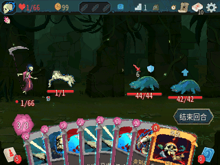

# Slay the Nspire 2

[](https://github.com/maxmixalex/slay-the-nspire-2/actions/workflows/ci.yml)
[](COPYING)

**English** | [简体中文](README.zh-CN.md)

An unofficial native adaptation of **Slay the Spire 2** for TI-Nspire calculators
running Ndless. Play the single-player campaign on a 320×240 screen, with five
characters, calculator controls, three save profiles, and the Timeline unlock chain.

The current **UI25** delivery targets the original **v0.111.0 / 41cef1ea** game
installation. You supply that game installation; the public project supplies
the runtime and conversion tools. Original game resources and calculator firmware
are not included.

<p align="center">
  
</p>

**UI25 · Necrobinder & Osty** — continuous Firebird LCD capture. The encounter
was prepared through the in-game console. Playback follows emulator time and
does not measure physical-device FPS. [Capture details](docs/media/README.md).

**[Installation and updates](docs/installation.md)** ·
**[Converter guide](docs/converter-ui23.md)** ·
**[Development](DEVELOPMENT.md)** ·
**[Release evidence](docs/ui25-release-validation.md)**

## What you can play

- The three-act single-player route, with Ironclad, Silent, Defect, Regent and
  Necrobinder, regional encounters, events, Ancients and map history.
- The 57-Epoch Timeline, with obtain/reveal progression and saved unlocks.
- English and Simplified Chinese by default, with fourteen optional original locales.
- Full sampled actor animation, or a smaller edition that keeps essential actor
  poses and original action durations.
- Three independent profiles, saved runs, settings, collection screens and paged
  run history. Touchpad and keyboard controls can be remapped.

Audio, multiplayer, cloud saves and hosted leaderboards are still unimplemented.
The [release record](docs/ui25-release-validation.md) describes remaining visual
differences, loading stalls and the exact coverage of testing.
A new ordinary Firebird check passed the touchpad Custom Run start/save/exit
route in an isolated legacy-compatible profile, with no relaunch during a
30-second OS observation. The historical failure's original trigger and cause
remain unknown; see the [exact input scope and timing](docs/ui25-player-feedback-reconciliation.md#touchpad-custom-run-check-and-historical-exit-issue).

## Choose an edition

Both editions use the same `nSpire2.tns` launcher. The data selects the animation
profile automatically; there is no separate launcher or setting to switch.

| Edition | Presentation | Measured UI25 installation |
| --- | --- | ---: |
| **Full animation** | Sampled character and enemy animation | **69,839,495 bytes** — about 69.84 MB |
| **Reduced actor animation** | Essential poses with the same action durations; some scene effects are held | **29,811,189 bytes** — about 29.81 MB |

These are the complete extracted English/Simplified-Chinese package sizes,
including instructions and licenses, before saves or optional languages. They are
not the compressed download sizes. See [package identities](docs/ui25-release-validation.md#three-matching-packages).
UI25 names this delivery and validation stage; the game may still display
`0.1.0-ui24`. Use the package's `BUILD-INFO` and recorded launcher identity to
identify the build.

## Quick start

### 1. Get the program files

You need a color-screen TI-Nspire with a working [Ndless](https://github.com/ndless-nspire/Ndless)
installation, the `nSpire2.tns` launcher, and a matching desktop converter.

| Program | Public build entry point |
| --- | --- |
| Calculator launcher | [Native tests and portable builds](https://github.com/maxmixalex/slay-the-nspire-2/actions/workflows/ci.yml) |
| Windows converter | [Windows original-install converter](https://github.com/maxmixalex/slay-the-nspire-2/actions/workflows/converter-windows.yml) |
| Build from source | [Development guide](DEVELOPMENT.md) |

Open a successful workflow run for the intended source checkpoint. The Windows
artifact is named `nspire2-converter-windows-<commit>` and contains
`nspire2-convert.exe` with dependency notices. Exact launcher artifact instructions
are in the [installation guide](docs/installation.md#get-the-program-files).
Public downloads contain no original game data; create the installation data
from your own game files.

The recorded UI25 emulator checks use **Firebird, TI-Nspire CX II CAS, OS
6.4.0.74 and Ndless r2022**. They are not physical-device tests or a compatibility
claim for every TI-Nspire model. [Environment and results](docs/ui25-release-validation.md)
are recorded separately from build results.

### 2. Convert your game

Put the standalone converter in the original game directory. It contains its
required runtimes, so no separate Python or .NET installation is needed.
For the default full-animation English/Simplified-Chinese conversion, Windows
users can double-click `nspire2-convert.exe`, or run:

```powershell
.\nspire2-convert.exe
```

On Linux, make the standalone file executable once, then run it:

```bash
chmod +x ./nspire2-convert
./nspire2-convert
```

Add `--no-animations` for reduced actor animation, or `--languages all` for all
sixteen locales. If your downloaded file has a version suffix, use its actual
filename. The converter writes a complete `data/` directory and a receipt; it
**does not generate the launcher**. [Conversion options and resume behavior](docs/converter-ui23.md)
explain alternate locations, language selection and progress.

### 3. Transfer and play

Copy `nSpire2.tns` and the converter's **entire `data/` directory** into the same
game directory on the calculator. Open `nSpire2.tns`. The game creates `state/`
for profiles and saves. Keep all eight artwork parts and the English language
file, then choose your installed language in Settings.

**When updating, exit the game and back up the whole `state/` directory.**
Keep that directory, replace the launcher and complete `data/` with a matching
new set, and replace optional locales too. Language files from another conversion
or animation profile must not be mixed. The [installation guide](docs/installation.md)
includes the exact directory layout, optional-language mapping and rollback steps.

## Controls

| Calculator input | Action |
| --- | --- |
| Touchpad edges / center | Navigate / click |
| `1`–`9`, `0` | Select the ten hand slots |
| `Enter` | Aim or confirm |
| `Esc` | Back or pause |
| `Menu` | End turn |
| `Tab` | Map |
| `Doc` | Deck |
| `Flag` | Developer console |

Both input banks are remappable in Settings. On Custom/Daily setup, the native
Confirm/Menu action starts the run when released; Enter operates the selected
field or character. Timeline is available from the title menu: inspect a node
with Enter, then press Enter again to reveal it when obtained.

Long ASCII seeds can be encoded by the desktop converter and entered through
the Custom Run field's explicit **Import seed code** option. See
[seed import](docs/installation.md#long-ascii-seeds) for the complete steps.

## Development and evidence

[DEVELOPMENT.md](DEVELOPMENT.md) covers repository layout, builds and tests.
The [documentation index](docs/README.md) separates the current release,
feature references and historical records. [WORK_STATE.md](docs/WORK_STATE.md)
is the maintainer's continuation log.

The UI25 release record identifies the tested runtime, converter outputs,
archive checks and full/reduced Firebird scenarios. Native tests, emulator
measurements and physical-handheld performance are distinct; no universal FPS
or complete original-game equivalence is claimed.

## License and acknowledgements

Project source is [GPL-3.0-or-later](COPYING). Preserve [NOTICE.md](NOTICE.md)
and the applicable [third-party notices](licenses/) when redistributing software.
Slay the Spire 2 and its assets belong to Mega Crit and their respective owners.
This project is unofficial and is not endorsed by Mega Crit; the source license
does not grant rights to redistribute game content.

Thanks to [Ndless](https://github.com/ndless-nspire/Ndless),
[Firebird](https://github.com/nspire-emus/firebird), and
[nZATO](https://github.com/zyf722/nZATO) for the offline-content/native-runtime
approach and the inspiration for this repository's player-oriented presentation.
