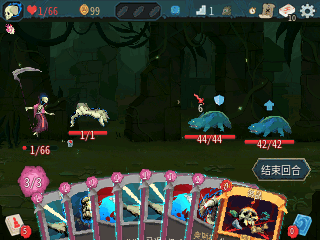

# Slay the Nspire 2

[](https://github.com/maxmixalex/slay-the-nspire-2/actions/workflows/ci.yml)
[](COPYING)

[English](README.md) | **简体中文**

将 **Slay the Spire 2（杀戮尖塔 2）**移植到运行 Ndless 的 TI-Nspire 计算器上。
在 320×240 的屏幕上构筑牌组、选择路线，向尖塔进发。

<p align="center">
  
</p>

*亡灵契约师与 Osty 的战斗演示。[使用 Firebird 录制](docs/media/README.md)。*

## 主要特性

- 三幕单人战役，逐步解锁五名角色。
- 战斗、事件、商店、休息点与原版地区地图。
- 默认支持英语和简体中文，可选其他原版语言。
- 完整动画版，以及占用空间更小的精简动画版。
- 三个独立档案、对局存档、卡牌图鉴和历史记录。
- 触摸板与键盘操作，支持修改键位。

目前不含音频和多人游戏。

## 快速开始

你需要一台已安装 [Ndless](https://github.com/ndless-nspire/Ndless) 的彩屏 TI-Nspire，
以及自己拥有的受支持版本《杀戮尖塔 2》。游戏版本和设备准备请见
[安装指南](docs/installation.zh-CN.md)。

### 下载程序

在成功的 GitHub Actions 构建中，从 **Artifacts** 下载对应文件：

| 下载 | 解压后使用的文件 |
| --- | --- |
| [计算器启动器](https://github.com/maxmixalex/slay-the-nspire-2/actions/workflows/ci.yml) | `nSpire2.tns` |
| [Windows 转换器](https://github.com/maxmixalex/slay-the-nspire-2/actions/workflows/converters.yml) | `nspire2-convert.exe` |

转换器已包含所需依赖。游戏数据由你本机的原版安装转换得到。

### 转换游戏

将 `nspire2-convert.exe` 放入原版游戏目录，双击运行。
默认生成中英双语数据，输出位于 `nSpire2-converted/data/`。

需要精简动画版时，运行 `nspire2-convert.exe --no-animations`；
加上 `--languages all` 可生成全部语言。转换需要一些时间，
中断后重新运行相同命令即可复用已完成的步骤。

指定其他目录、Linux 用法和转换器源码构建方法请见[转换器指南](docs/converter.md)。

### 传入计算器

将启动器与生成的**整个 `data/` 文件夹**放在计算器的同一目录下：

```text
Slay the Nspire 2/
  nSpire2.tns
  data/
```

打开 `nSpire2.tns` 即可游玩。游戏会创建 `state/` 文件夹保存进度和设置。
更新前请备份并保留这个文件夹，将启动器和游戏数据一起替换。
语言可以在设置中切换。

## 操作

| 输入 | 功能 |
| --- | --- |
| 滑动／按下触摸板 | 移动光标／点击 |
| 方向键 | 菜单导航 |
| `1`–`9`、`0` | 选择手牌 |
| `Enter` | 确认或瞄准 |
| `Esc` | 返回或暂停 |
| `Menu` | 结束回合 |
| `Tab` | 地图 |
| `Doc` | 牌组 |

设置中可修改键位、开启轻触点击或调整鼠标速度。轻触点击默认关闭。

## 开发

源码构建、测试和目录说明见[开发指南](DEVELOPMENT.md)。

## 许可证与致谢

项目源码使用 [GPL-3.0-or-later](COPYING)，第三方来源见 [NOTICE.md](NOTICE.md)。
《杀戮尖塔 2》及其素材归 Mega Crit 和相应权利人所有。
本项目为非官方移植，不包含原版游戏数据。

感谢 [Ndless](https://github.com/ndless-nspire/Ndless)、
[Firebird](https://github.com/nspire-emus/firebird) 和
[nZATO](https://github.com/zyf722/nZATO)。
