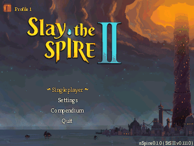
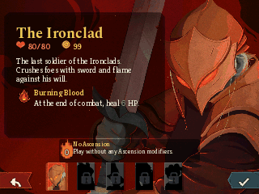
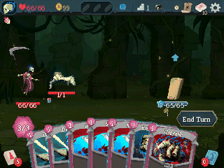
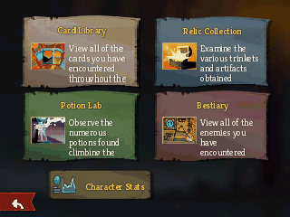
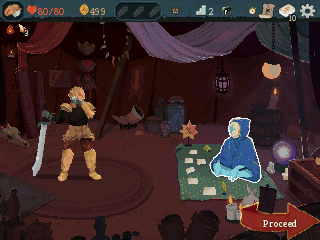
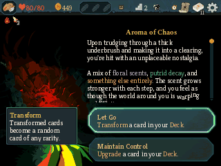
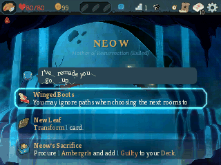
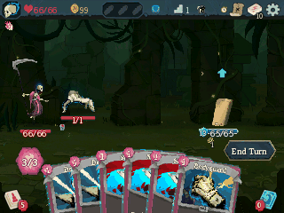
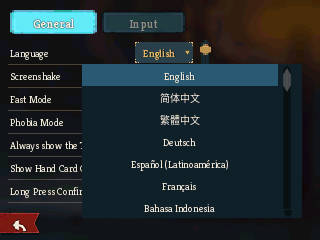

# Slay the Nspire 2

[](https://github.com/maxmixalex/slay-the-nspire-2/actions/workflows/ci.yml)
[](LICENSE)


[English](README.md) | **简体中文**

《杀戮尖塔 2》到 TI-Nspire Ndless 平台的非官方移植。选一名角色，接受先古之民的馈赠，带着自己的牌组开始爬塔。桌面转换器负责从你自己的电脑游戏里准备图像和文字。 [Steam 游戏页面](https://store.steampowered.com/app/2868840/Slay_the_Spire_2/)

<table width="100%" align="center">
  <tr>
    <td width="33%" align="center" valign="center">
      <strong>主菜单与动态标题</strong>
    </td>
    <td width="33%" align="center" valign="center">
      <strong>角色选择与教程</strong>
    </td>
    <td width="33%" align="center" valign="center">
      <strong>与奥斯提并肩战斗</strong>
    </td>
  </tr>
  <tr>
    <td width="33%" align="center" valign="center">
      
    </td>
    <td width="33%" align="center" valign="center">
      
    </td>
    <td width="33%" align="center" valign="center">
      
    </td>
  </tr>
  <tr>
    <td width="33%" align="center" valign="center">
      <strong>百科大全</strong>
    </td>
    <td width="33%" align="center" valign="center">
      <strong>商店</strong>
    </td>
    <td width="33%" align="center" valign="center">
      <strong>普通事件与选择</strong>
    </td>
  </tr>
  <tr>
    <td width="33%" align="center" valign="center">
      
    </td>
    <td width="33%" align="center" valign="center">
      
    </td>
    <td width="33%" align="center" valign="center">
      
    </td>
  </tr>
  <tr>
    <td width="33%" align="center" valign="center">
      <strong>先古之民与地图</strong>
    </td>
    <td width="33%" align="center" valign="center">
      <strong>游戏控制台</strong>
    </td>
    <td width="33%" align="center" valign="center">
      <strong>十六种语言</strong>
    </td>
  </tr>
  <tr>
    <td width="33%" align="center" valign="center">
      
    </td>
    <td width="33%" align="center" valign="center">
      
    </td>
    <td width="33%" align="center" valign="center">
      
    </td>
  </tr>
</table>

以上画面均录自 Firebird 中运行的游戏，保留计算器原生分辨率。部分场景通过游戏内控制台准备。最后一段集中展示语言列表及几种语言下的战斗。

## 主要特性

- 支持铁甲战士、静默猎手、储君、亡灵契约师和故障机器人，包含卡牌、遗物、药水、敌人、事件与先古之民的单人爬塔流程。
- 保留人物和怪物动作、动态标题、战斗特效与转场，并针对计算器屏幕调整显示。
- 提供全动画和精简动画两种数据包。精简版保留必要姿势，两种版本共用启动器与存档。
- 支持触摸板与键盘操作、卡牌和物品详情、交互式地图，可调节指针速度和轻触单击。
- 百科大全包含卡牌库、遗物收藏、药水实验室与怪物图鉴，同时提供本地档案、对局历史和游戏控制台。
- 支持原版的十六种语言，默认生成英文与简体中文，其他语言可按需选装。

## 软硬件支持

### 支持机型

面向安装 Ndless 的 TI-Nspire 彩屏计算器开发。开发与画面录制使用 Firebird 中的 TI-Nspire CX II CAS，内存采用计算器的正常配置。电脑用于转换原版游戏和传送文件。 [Firebird](https://github.com/nspire-emus/firebird)

### OS 与 Ndless 版本

已验证的组合为 TI OS 6.4.0.74、Ndless r2022 和 Zehn 启动器。请先为计算器的系统版本安装对应的 Ndless。 [Ndless](https://ndless.me/)

当前移植版本为 **nSpire 0.1.0**，针对 **StS II v0.111.0** 开发。转换器从实际游戏安装中读取原版版本，并写入数据包，标题画面会显示正在使用的数据版本。目前支持单人游玩，暂未提供声音、联机和在线服务。

## 快速开始

### 下载工具

打开一次成功完成的工作流，在 **Artifacts** 栏下载需要的 ZIP。计算器启动器与桌面转换器分别构建。

| 下载内容 | 工作流 | 包含文件 |
| --- | --- | --- |
| `nspire2-launcher` | [CI](https://github.com/maxmixalex/slay-the-nspire-2/actions/workflows/ci.yml) | 计算器程序 `nSpire2.tns` |
| `nspire-converter-windows` | [桌面转换器](https://github.com/maxmixalex/slay-the-nspire-2/actions/workflows/converters.yml) | Windows 程序 `nspire-converter.exe` |
| `nspire-converter-linux` | [桌面转换器](https://github.com/maxmixalex/slay-the-nspire-2/actions/workflows/converters.yml) | Linux 程序 `nspire-converter` |

转换器使用 Nuitka 打包，内含 Python 依赖和所需的原生辅助程序，解压后即可运行。

如果已有完整安装包，可以直接看下方的“传入手持设备”。

### 创建内容包

在 Steam 中选择**杀戮尖塔 2 → 管理 → 浏览本地文件**。把转换器放到这个目录，与 `SlayTheSpire2.pck` 和 `release_info.json` 放在一起。在 Windows 上运行 `nspire-converter.exe`，在 Linux 上运行 `./nspire-converter`。

不带参数时，转换器会把中英双语全动画数据写入 `nSpire2-converted/data/`。转换包括提取游戏资源、采样动画、准备字形和压缩数据，进度显示会依次跟随这些步骤。

需要精简动画或其他语言时，可以通过命令行选择。

```powershell
.\nspire-converter.exe --no-animations
.\nspire-converter.exe --languages eng,zhs,jpn
.\nspire-converter.exe --languages all
```

`--no-animations` 会单独写入 `nSpire2-converted-no-animations/data/`。语言包自带文字和字形，可以只选自己需要的语言。完整参数见 `nspire-converter --help`。

如果 ASCII 种子太长，可以先用 `nspire-converter --encode-seed-file seed.txt` 生成短码，再在自定义模式的种子输入框中选择“导入种子码”。

### 传入手持设备

使用平时传送 TI 文件的软件，把 `nSpire2.tns` 和配套的完整 `data/` 目录放在计算器的同一个文件夹，然后从“我的文档”打开 `nSpire2.tns`。

| 文件或目录 | 内容 |
| --- | --- |
| `nSpire2.tns` | 两种数据包共用的启动器 |
| `data/` | 游戏资源、动画、已选语言和原版游戏版本 |
| `state/` | 游玩时生成的档案、对局、历史、设置和备份 |

游戏优先使用已安装的系统语言，然后尝试英文或第一个可用语言。需要更换时，在主菜单的“设置”中选择语言。

升级时先退出游戏，保留整个 `state/`，然后同时替换启动器与 `data/`。选装其他语言时，全动画版从语言 ZIP 的 `full/data/` 取文件，精简版从 `reduced/data/` 取文件，放入现有的 `data/` 目录。

## 控制

| 按键或手势 | 功能 |
| --- | --- |
| 滑动触摸板 | 移动指针 |
| 按下触摸板中键 | 有指针时在指针处点击，没有指针时确认选中项 |
| 方向键 | 移动选中项。抬手后再次滑动即可切回指针 |
| `1`–`9`、`0` | 选择手牌 |
| `Enter` | 确认选项或目标 |
| `Esc` | 返回或暂停 |
| `Menu` | 结束回合 |
| `Tab` / `Doc` | 打开地图 / 牌组 |
| 旗标键 | 打开游戏控制台 |

可以在“设置”中开启“轻触点击”，并调整“鼠标速度”。按键绑定位于“设置 → 操作设置”。这些偏好会保存在计算器上。

## 开发

计算器游戏使用 C++，桌面转换器使用 Python、Poetry 与 Nuitka。目录结构、构建命令和代码检查见开发指南。 [开发指南](DEVELOPMENT.md)

## 许可证与声明

本移植采用 GPL-3.0-or-later。原版《杀戮尖塔 2》及其素材属于 Mega Crit 与相应权利人。自行创建数据包需要你自己的电脑游戏安装。 [许可证](LICENSE)

本项目使用 Codex 辅助开发，是独立于 Mega Crit 的非官方爱好者项目。

## 鸣谢

- 感谢 Mega Crit 制作《杀戮尖塔 2》。 [原版游戏](https://store.steampowered.com/app/2868840/Slay_the_Spire_2/)
- 感谢 Ndless 项目的贡献者让 TI-Nspire 能运行原生程序。 [Ndless](https://github.com/ndless-nspire/Ndless)
- 感谢 Firebird 项目提供开发时使用的 TI-Nspire 模拟器。 [Firebird](https://github.com/nspire-emus/firebird)
- 感谢 nZATO 提供转换器与启动器的移植思路，以及项目组织参考。 [nZATO](https://github.com/zyf722/nZATO)
- 感谢本项目所用第三方代码与字体的作者。 [致谢与许可证说明](cpp/third_party/notices/ATTRIBUTIONS.txt)
